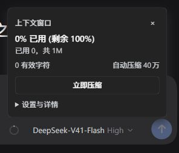

# dsh-context-control

DeepSeek Harness 上下文压缩插件。模型选择器旁显示上下文用量环，点击可查看窗口占用、有效字符、窗口容量、最近压缩和原文，修改阈值或手动压缩。窗口计量采用“已用 53k，共 1M”的简洁显示；字符压缩触发线单独标明。

**首版目标：DSH 0.2.0-rc.2。** 使用该版本原生 Session、TokenMeter、StorageDomain、投影、命令及 UI 插槽。其他版本需重新验证；不要直接将本包视作兼容所有 dsh 版本。



Context usage ring and recoverable compaction for DeepSeek Harness 0.2.0-rc.2. Automatic compaction defaults to **400,000 active characters**, with a configurable threshold and manual control. The compact panel uses quiet native RPC and preserves access to original history. Summaries use the session's model and incur normal model API usage.

## 功能

- 默认有效上下文达到 **400,000 字符**自动压缩，范围 10,000–5,000,000；支持关闭自动压缩、当前会话设置和全局默认。
- 手动压缩；工作进行中排队到安全边界，可取消待执行请求。
- 保留最新用户消息和近期工作；被替换的真实用户要求原文加入检查点，历史修正按时间排序。
- 结构化摘要保留任务、约束、决策、文件变化、验证证据、失败与待办。
- 使用官方持久化压缩事务，保留工具调用配对。失败、取消、输出截断或并发历史变化时不替换原上下文。
- 原始会话事件保留，可通过界面或 `context_control` 工具分页回查；成功的 shell 输出只折叠连续完全重复的长日志，先保存原文，保存失败则保留输出。
- 中英文及 dsh 原生主题；通过 `conversation.input.right` 插槽加载。

这里的字符按 Unicode 码点计数，包含当前消息和工具定义的可见文本；图片字节不计入字符。窗口比例来自 dsh token 投影/估算，与字符触发线分别显示。未知模型容量时不显示虚假的百分比。接近模型窗口上限会提前触发安全压缩，自动关闭时同时关闭该提前触发；上下文溢出恢复另由 `overflowRecoveryEnabled` 控制。

包内声明的可选 peer 由匹配版本的 DSH 宿主提供，不会另装一套 Harness；独立 Node 程序中不能直接运行本插件。

## 安装

从 [GitHub Releases](https://github.com/sxwer001/dsh-context-control/releases) 下载预构建的 `.tgz` 安装包；使用 DSH 0.2.0-rc.2。也可以直接安装固定版本：

```sh
dsh plugin --profile web add https://github.com/sxwer001/dsh-context-control/releases/download/v0.1.2/dsh-context-control-0.1.2.tgz
dsh --profile web
```

将 `dsh-context-control-0.1.2.tgz` 通过 dsh 的插件管理安装本地包入口安装，或在支持 CLI 的自定义/web profile 中：

```powershell
dsh plugin --profile web add 'D:\path\dsh-context-control-0.1.2.tgz'
dsh --profile web
```

桌面 profile 由 Electron 管理，可使用桌面内插件管理器，或完整关闭应用后使用安装目录内的官方命令入口：`resources/runtime/cli/bin/dsh.cmd plugin --profile desktop add <包路径>`。不要手动改写其依赖和配置。包内 `cordis.patch.yml` 注册插件。重载后在会话输入区模型选择器旁出现小环。首次操作需已有会话；模型未配置时可以保存设置，摘要需要有效模型路由。

已有 billion-context 或其他压缩插件时，建议先在独立 profile 验证再决定保留哪个自动压缩策略。此包不替换原生 `compaction` 服务；多种自动策略同时启用的先后顺序及收益需实测。

## 使用

点环显示紧凑用量卡片，可直接“立即压缩”。展开“设置与详情”后修改字符阈值 → “应用”保存当前会话；“设为全局默认”供未覆盖设置的会话使用。关闭自动压缩后仍可手动压缩。正在运行的任务显示“在安全边界压缩”。无安全旧历史时保留原上下文并提示。

面板通过原生认证 RPC 静默操作，不产生聊天命令记录；旧版面板留下的 `context-control` 行隐藏显示，原始会话数据仍保留。命令与模型工具共用同一 Host 操作：

```text
/context-control status
/context-control compact
/context-control {"action":"configure","scope":"session","settings":{"triggerChars":600000,"autoEnabled":true}}
/context-control {"action":"cancel"}
/context-control {"action":"history"}
```

工具 `context_control` 接受同样的 JSON；大段原文响应包含 `next`，按它继续请求。只回查当前会话的原文。原文属于历史资料，应依据当前要求解释。

## 技术路线与限制

复用官方 `@deepseek-ai/dsh-compaction-basic` 的选择/事务实现，仅暴露内部辅助函数，来源版本与哈希在 `vendor/upstream.json`，许可见 `THIRD_PARTY_NOTICES.md`。参考 [dsh 官方实现](https://github.com/deepseek-ai/deepseek-harness)、[dsh-compressor](https://github.com/lifeodyssey/dsh-compressor) 与 [billion-context-dsh](https://github.com/Tyan66666/billion-context-dsh) 的分层记忆思路；本包不捆绑这些第三方项目的代码。

摘要默认调用会话最近请求的模型，可在 Host 配置中指定 `summarizationProvider` 和 `summarizationModel`（必须成对设置）。尽量复用真实请求前缀以利用缓存。原始用户要求超过 64,000 字符时拒绝替换，以免保护内容反而使摘要膨胀。

摘要属于有损压缩，原文可回查及明确要求保留降低丢失风险，**不能保证模型后续工作完全不受影响**。累计费用取决于缓存命中、摘要费用及后续轮数；上下文变短不等于已证明账单下降。自动化验证使用脚本模型，另外已完成下述真实模型会话验证，没有宣称真实节省比例。

## 开发与验证

需要 Node ≥22.19；本地验证使用 Node 24 和已安装的 DSH 0.2.0-rc.2。

```powershell
node scripts/prepare-runtime.mjs 'D:\deepseekharness\resources\app.asar' --include-cli
npm run check
npm test
npm pack
```

脚本只读取安装包，将运行依赖复制到任务目录 `.test-runtime`，不会修改 dsh 安装或用户 profile。测试使用真实 Session、投影、计量、StorageDomain/JSON 存储和原生压缩事务；模型流及命令/工具注册服务由本地脚本提供。覆盖字符计数、设置、事务失败回退、取消、并发、原文恢复、摘要继承和工具调用配对。真实模型的工作连续性和费用收益仍需对照评测。

2026-10-12 本地验证：21 项自动化检查通过；安装包已在独立 dsh web profile 加载，用量环位置、详情、自定义阈值保存、重启后设置恢复、无历史手动压缩提示与非法阈值拒绝均已通过界面检查。0.1.1 将默认卡片收紧到约 264 × 182 像素，设置与原文回查折叠显示；0.1.2 将面板查询改为静默原生 RPC，显示简洁窗口数字，并给设置展开/收起加入 200ms 原生高度过渡，尊重系统减少动画设置。验证了重复开关面板不新增聊天命令事件，RPC 手动压缩及原文恢复仍正常。

随后已通过官方命令入口安装到用户的 desktop profile，并创建实际测试会话“上下文压缩插件实际测试 2026-10-12”。使用当前 `opencode-go / deepseek-v4.1-flash` 模型读取生成的公开测试数据：手动命令压缩从 124,481 字符降至 103,328 字符，原文回查成功；自动压缩在临时的 126,197 字符触发线上执行。两次压缩后的真实模型回答均准确保留测试标记和构建约束。测试会话的近期保留预算临时设为 1,000 token / 2 条消息，结束后已恢复原设置及 400,000 字符触发线；全局默认未改变。本次未对真实工作任务的质量或账单节省比例作普遍性结论。结果保存在本地 `.test-state/live-result.json`。

开发遵循用户指定的 Ponytail full 模式：原生能力优先，不新增运行依赖和架构层；必要的数据恢复与边界验证保留。
